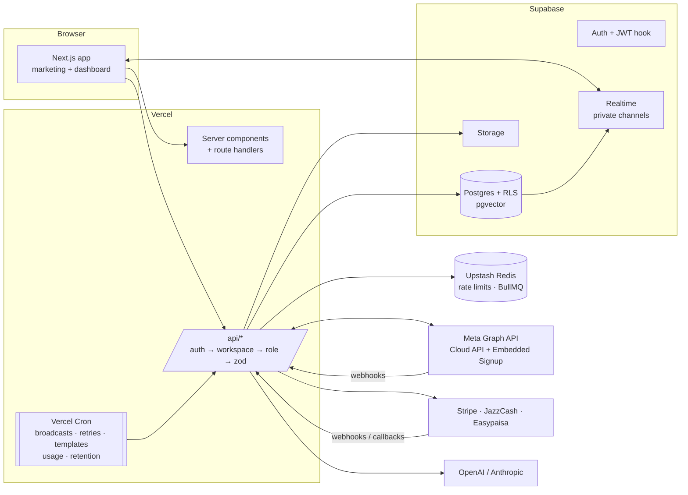

# Talkzi

**Run your business on WhatsApp.** Talkzi is a multi-tenant WhatsApp management SaaS: a shared
inbox, broadcasts, chatbots, AI replies, analytics and integrations, built on Meta's **official
WhatsApp Business Cloud API** with **Embedded Signup**. It ships with PKR + USD pricing, local
wallets, Urdu opt-out keywords and agency white-labelling, and it's made in Pakistan.

> No Baileys, no QR codes, no Socket.io, no Docker. Everything runs serverless on Vercel +
> Supabase + Upstash.

- **Windows setup guide:** [SETUP.md](SETUP.md)
- **Meta App Review & Tech Provider checklist:** [METASUBMISSION.md](METASUBMISSION.md)
- **API docs:** `/docs` in the app, plus `/api/public/v1/openapi.json`

---

## Contents

- [Features](#features)
- [Architecture](#architecture)
- [Repository layout](#repository-layout)
- [Tech stack](#tech-stack)
- [Quick start (Windows)](#quick-start-windows)
- [Environment variables](#environment-variables)
- [Scripts](#scripts)
- [Meta (WhatsApp) configuration](#meta-whatsapp-configuration)
- [Deploying](#deploying)
- [Security model](#security-model)
- [Testing](#testing)
- [Design decisions](#design-decisions)
- [What is stubbed or needs real keys](#what-is-stubbed-or-needs-real-keys)
- [Roadmap](#roadmap)

---

## Features

| Area | What you get |
| --- | --- |
| **Onboarding** | Email + password, magic link and Google sign-in; workspace wizard; invitations with signed tokens; roles owner / admin / agent / viewer; workspace switcher |
| **WhatsApp connection** | Meta Embedded Signup (FB JS SDK v21.0, `config_id`, session info v2), code → business token exchange, number registration with PIN, webhook subscription, display name / quality / tier per number, developer fallback with a system user token |
| **Webhooks** | `X-Hub-Signature-256` verification, idempotent by `wamid`, every raw payload stored, all message types, statuses, template / quality / name / account events, automatic retries |
| **Shared inbox** | 3-pane realtime inbox (Supabase Realtime private channels), assignment, snooze, resolve, labels, internal notes, `/slash` canned replies, media upload/download, agent collision detection, AI panel (suggested reply, summary, sentiment, intent) |
| **24-hour window** | Server-side `SESSION_WINDOW_CLOSED` for free-form sends; composer switches to the approved-template picker when the window is closed |
| **Contacts / CRM** | Virtualized table, filters, labels, custom fields, profile with history, CSV import wizard (consent required), CSV export, per-contact data export and erasure |
| **Templates** | Wizard (category → language → name → header/body/footer/buttons), live WhatsApp-bubble preview, submit to Meta, status via webhook + sync cron, approved templates locked from editing |
| **Broadcasts** | Wizard (number → template → variable mapping → audience → schedule → review), BullMQ or Postgres queue, per-minute cron runner within messaging-tier limits, auto-pause on RED quality or account errors, live progress, reply attribution |
| **Chatbots** | React Flow builder (Message, Ask, Buttons, Condition, Set variable, HTTP request, Send template, Add label, AI answer, Hand off / assign, End), live test simulator, server-side executor with one live session per conversation |
| **AI** | Provider abstraction: OpenAI (default) or Anthropic Claude, with offline heuristics when no key is set; RAG over uploaded documents with pgvector; monthly AI credits per plan |
| **Analytics** | Volume, first-response times, delivery/read rates, CSAT, broadcast results, Meta cost by pricing category, number quality history; every chart has a table view |
| **Integrations** | Public REST API v1 (scoped `tk_live_` keys, rate limited, cursor pagination, OpenAPI), signed outgoing webhooks with retries and delivery log, Zapier / n8n / Google Sheets / custom incoming webhooks, Shopify / WooCommerce / Stripe events mapped to approved templates |
| **Billing** | Stripe Checkout with price lookup keys, in-app plan switching with proration, customer portal; JazzCash / Easypaisa prepaid PKR plans; usage meters and plan limits enforced in API and SQL |
| **Agency** | White-label brand (name, logo, favicon, colours with WCAG checks), client workspaces that inherit the agency plan and brand, custom sign-in domain with DNS verification |
| **Compliance** | Opt-out / opt-in keywords incl. `BAND KARO` and `بند کرو`, message retention (default 365 days), workspace JSON export, workspace deletion with confirmation codes, Meta data-deletion and deauthorize callbacks, legal pages |
| **Marketing site** | Hero, features, how it works, competitor comparison, PKR/USD pricing, testimonials, FAQ, blog, docs, security, privacy, terms, data deletion; OG images, sitemap, robots |

## Architecture



- **Multi-tenancy:** every tenant row has `workspace_id`. Row-level security compares it with `current_workspace_id()`, which comes from a JWT claim set by a Supabase auth hook and is re-checked against live membership. Writes are gated by minimum role.
- **Privileged work** (recording messages, broadcast claims, billing activation, client workspace creation, purges) runs through `service_role`-only SQL functions, called from route handlers after authorization.
- **Every API route** uses one pipeline (`apps/web/src/lib/api/handler.ts`): rate limit → auth → workspace → role → plan feature → Zod → handler → typed `{ data }` / `{ error }` response.
- **Serverless jobs:** Vercel Cron hits `/api/cron/*` with `Authorization: Bearer $CRON_SECRET`. Each job is idempotent and stays within a time budget.

## Repository layout

```text
talkzi/
├── apps/web/                 Next.js 16 app: marketing, dashboard, API, webhooks, crons
│   ├── src/app/              routes (app router), API route handlers, metadata routes
│   ├── src/components/       marketing, auth, dashboard (inbox, broadcasts, chatbots…)
│   ├── src/lib/              domain services (messaging, broadcasts, billing, compliance…)
│   ├── test/                 Vitest suites (mocked Meta / Stripe / Supabase)
│   └── vercel.json           cron schedule
├── packages/
│   ├── db/                   Supabase SQL migrations, generated types, seed, PGlite test harness
│   ├── shared/               Zod schemas, plans & pricing, roles, phone utils, constants
│   ├── whatsapp/             typed Cloud API client, retries, error normalizer, webhook parser
│   └── ui/                   shadcn-style components + Talkzi theme tokens (dark/light)
├── .env.example              every environment variable, documented
├── SETUP.md                  Windows-friendly setup guide
└── METASUBMISSION.md         Meta App Review + Tech Provider checklist
```

## Tech stack

| Layer | Choice |
| --- | --- |
| Framework | Next.js 16 (App Router, Turbopack, `proxy.ts`), React 19, TypeScript (strict) |
| Styling | Tailwind CSS v4, shadcn-style components on Radix, Inter, dark default + light theme |
| Data | Supabase Postgres (RLS, pgvector, pg_trgm), Auth, Storage, Realtime |
| State / forms | TanStack Query v5, Zustand, react-hook-form + Zod 4 |
| Queues & limits | Upstash Redis (`@upstash/ratelimit`), BullMQ (optional) with a Postgres `SKIP LOCKED` fallback |
| UI extras | Lucide icons, Recharts v3, React Flow (`@xyflow/react`), TanStack Virtual, Framer Motion |
| AI | OpenAI SDK (Responses API, structured outputs) and Anthropic SDK behind one interface |
| Payments | Stripe (cards, USD/PKR) + JazzCash / Easypaisa adapters |
| Email | Resend (console fallback) |
| Logging | pino (structured, request ids) |
| Tests | Vitest; PGlite runs the real SQL migrations in-process (no Docker) |
| Tooling | pnpm workspaces + catalog, ESLint (incl. React Compiler rules), Prettier, `rimraf` / `cross-env` for Windows |

## Quick start (Windows)

Full walkthrough: **[SETUP.md](SETUP.md)**.

```powershell
git clone https://github.com/muqniturrehman/talkzii.git
cd talkzii
pnpm install
Copy-Item .env.example apps/web/.env.local
Copy-Item .env.example .env.local
# fill in Supabase keys + generated secrets (SETUP.md §3–4), then:
pnpm db:migrate
pnpm db:seed
pnpm dev
```

Open http://localhost:3000 and sign in as `owner@demo.talkzi.app` / `Talkzi@demo123`. The seeded
mock WhatsApp number lets you use the inbox and broadcasts before you have Meta credentials.

## Environment variables

All variables live in [`.env.example`](.env.example). Missing optional keys never crash the app;
the feature degrades or is hidden.

| Group | Variables | Required? | Without it |
| --- | --- | --- | --- |
| App | `NEXT_PUBLIC_APP_URL` | yes (prod) | defaults to `http://localhost:3000` |
| Supabase | `NEXT_PUBLIC_SUPABASE_URL`, `NEXT_PUBLIC_SUPABASE_ANON_KEY`, `SUPABASE_SERVICE_ROLE_KEY`, `DATABASE_URL` | **yes** | sign-in disabled, setup banner shown |
| Security | `ENCRYPTION_KEY`, `INTERNAL_API_SECRET`, `CRON_SECRET` | **yes (prod)** | dev-only insecure key; crons open outside production |
| Meta | `META_APP_ID`, `META_APP_SECRET`, `META_CONFIG_ID`, `META_WEBHOOK_VERIFY_TOKEN`, `NEXT_PUBLIC_META_APP_ID`, `NEXT_PUBLIC_META_CONFIG_ID`, `META_GRAPH_API_VERSION`, `META_SYSTEM_USER_TOKEN`, `WHATSAPP_MOCK` | for real WhatsApp | connect page explains what's missing; seeded mock number keeps working |
| Upstash | `UPSTASH_REDIS_REST_URL`, `UPSTASH_REDIS_REST_TOKEN`, `REDIS_URL` | recommended (prod) | in-memory rate limits; Postgres broadcast queue |
| AI | `AI_PROVIDER`, `OPENAI_API_KEY`, `OPENAI_MODEL`, `OPENAI_EMBEDDING_MODEL`, `ANTHROPIC_API_KEY`, `ANTHROPIC_MODEL` | optional | offline heuristics + hash embeddings |
| Billing | `STRIPE_SECRET_KEY`, `STRIPE_WEBHOOK_SECRET`, `NEXT_PUBLIC_STRIPE_PUBLISHABLE_KEY`, `JAZZCASH_*`, `EASYPAISA_*` | optional | upgrade buttons explain that payments aren't configured |
| Agency domains | `CUSTOM_DOMAIN_CNAME_TARGET`, `VERCEL_API_TOKEN`, `VERCEL_PROJECT_ID`, `VERCEL_TEAM_ID` | optional | domains verified by DNS, attached in Vercel manually |
| Email | `RESEND_API_KEY`, `EMAIL_FROM` | optional | emails printed to the server log |
| Observability | `LOG_LEVEL` | optional | `info` |

## Scripts

| Command | What it does |
| --- | --- |
| `pnpm dev` | Next.js dev server (`apps/web`) |
| `pnpm build` / `pnpm -r build` | Production build of every package |
| `pnpm -r typecheck` | Strict TypeScript across the monorepo |
| `pnpm test` | Vitest in every package |
| `pnpm lint` | ESLint |
| `pnpm format` | Prettier |
| `pnpm db:migrate` | Apply pending SQL migrations to `DATABASE_URL` (no Docker / Supabase CLI) |
| `pnpm db:seed` | Demo workspace, users, mock number, contacts, conversations, templates, broadcast, chatbot |
| `pnpm db:types:local` | Regenerate `packages/db/types.ts` from the migrations via PGlite |
| `pnpm db:types` | Regenerate types from a remote Supabase project (Supabase CLI) |
| `pnpm clean` | Remove build output and `node_modules` (via `rimraf`) |

## Meta (WhatsApp) configuration

The short version is below. The complete, reviewer-ready version is [METASUBMISSION.md](METASUBMISSION.md).

1. Create a **Business** app with the **WhatsApp**, **Facebook Login for Business** and **Webhooks** products.
2. Create an **Embedded Signup** configuration (system-user token, `whatsapp_business_management` + `whatsapp_business_messaging`) and copy its ID into `META_CONFIG_ID` / `NEXT_PUBLIC_META_CONFIG_ID`.
3. Webhook callback `https://<domain>/api/webhooks/meta`, with your verify token; subscribe the fields listed in METASUBMISSION.md §3.4.
4. Data deletion callback `https://<domain>/api/meta/data-deletion`; deauthorize callback `https://<domain>/api/meta/deauthorize`.
5. Privacy `/privacy`, terms `/terms`, data deletion instructions `/data-deletion`.
6. Request advanced access in App Review, then switch the app to **Live**.

Stripe webhook endpoint: `https://<domain>/api/billing/stripe/webhook`. Events: `checkout.session.completed`,
`customer.subscription.created|updated|deleted|paused|resumed` and `invoice.payment_failed`.

## Deploying

Vercel, with **Root Directory = `apps/web`**. See [SETUP.md §10](SETUP.md#10-deploy-to-vercel).

| Cron (`apps/web/vercel.json`) | Schedule | Purpose |
| --- | --- | --- |
| `/api/cron/broadcasts` | `* * * * *` | send due broadcast slices within tier limits |
| `/api/cron/webhook-retry` | `*/5 * * * *` | re-process failed inbound events, retry outgoing webhooks |
| `/api/cron/template-status` | `*/15 * * * *` | sync template statuses from Meta |
| `/api/cron/usage-rollup` | `0 * * * *` | expire prepaid plans, reconcile usage counters |
| `/api/cron/retention` | `30 21 * * *` | message retention + log cleanup (02:30 PKT) |

Per-minute crons need Vercel Pro. On Hobby, call the cron URLs from an external scheduler with the `CRON_SECRET` bearer token.

## Security model

- **Isolation:** RLS on every public table (enforced by a test). JWT workspace claim re-verified against membership. Column-level privileges stop admins editing plan, ownership or domain-verification fields through PostgREST.
- **Secrets:** WhatsApp tokens and integration secrets encrypted with AES-256-GCM (`ENCRYPTION_KEY`). API keys stored as SHA-256 hashes and shown once. The service-role key is server-only.
- **Inbound verification:** Meta `X-Hub-Signature-256`, Stripe signatures, Shopify / WooCommerce HMACs, Meta `signed_request`, JazzCash secure hash, integration tokens / `X-Talkzi-Signature`.
- **Outbound:** HMAC-signed webhooks (`t=…,v1=…`), SSRF guard on every delivery (https only, private IPs blocked, re-resolved per attempt).
- **Abuse controls:** rate limits on auth, the public API, sends, AI, billing and exports; plan limits enforced server-side; audit log for sensitive actions.
- **Headers:** HSTS, `X-Frame-Options`, `nosniff`, strict referrer policy, permissions policy.

## Testing

```powershell
pnpm test
```

| Package | Covers |
| --- | --- |
| `packages/whatsapp` | Cloud API client with mocked `fetch`, retry/backoff, error normalizer, webhook parsing |
| `packages/db` | The real migrations in PGlite: RLS isolation and role gates, service-only functions, inbound idempotency and the 24h window, broadcast claims, imports, audiences, billing activation, agency plan propagation, column privileges, retention purges, seed + analytics |
| `packages/shared` | Phone normalization, template drafts, plans / lookup keys, colour contrast, opt-out keyword matching |
| `apps/web` | Auth pipeline, Embedded Signup token exchange (mocked), webhook signature verification, send message + 24h window (mocked), broadcast enqueue/processing, chatbot execution, AI providers, outgoing webhooks + SSRF guard, public API helpers, Stripe sync + webhook dedupe, JazzCash/Easypaisa signing, agency domains, compliance flows |

## Design decisions

1. **Official Cloud API only.** Embedded Signup gives each business its own WABA and token. Talkzi is a Tech Provider, so Meta bills businesses directly, and Talkzi plans exclude Meta fees.
2. **Next.js 16 instead of 14.** The spec asked for 14+. 16 brings async request APIs, `proxy.ts` and React 19. The dashboard is dynamic per request; marketing pages are static.
3. **Postgres does the heavy lifting.** Message recording, broadcast claiming (`SKIP LOCKED`), audience materialization, imports, prepaid activation and purges are set-based SQL functions. That makes them atomic, idempotent and testable with PGlite.
4. **Serverless queues.** Broadcasts use BullMQ when `REDIS_URL` is set and fall back to a Postgres lease queue otherwise. A per-minute cron does the sending within each number's 24h tier.
5. **Webhooks inline + retry.** Meta webhooks are verified, stored raw and processed in the request; failures are retried by a cron. Processing is idempotent by `wamid`.
6. **Graceful degradation.** Every external service is optional in development: mock WhatsApp client, heuristic AI, console email, hidden payments, in-memory rate limits.
7. **Pakistan-first defaults.** Phone numbers default to `+92`, timezone `Asia/Karachi`, PKR prices next to USD, JazzCash/Easypaisa, Urdu opt-out keywords.
8. **AI is metered and swappable.** One `AiTasks` interface for OpenAI / Claude / heuristics, with plan-based monthly credits. RAG uses pgvector with per-model embeddings.
9. **Agency model.** Client workspaces are ordinary workspaces with `parent_workspace_id`. Plan and branding flow down (by trigger, and by merge at read time), billing goes through the agency, and the custom domain brands the sign-in pages.
10. **Docker-free tooling.** Migrations run through `pg` (`pnpm db:migrate`), types are generated from PGlite, and Windows works with no WSL.

## What is stubbed or needs real keys

| Item | Status |
| --- | --- |
| WhatsApp messaging, Embedded Signup, templates | Implemented against the Graph API v21.0. Needs a Meta app, and App Review for other businesses' accounts. Tested with mocked HTTP only |
| Stripe | Implemented (Checkout, portal, webhook, plan switching). Needs keys plus 8 prices with lookup keys. Tested with mocked Stripe objects |
| JazzCash | Signing + verified callback implemented for Page Redirection v1.1; prepaid only (no auto-renew). Check field formats against your merchant pack |
| Easypaisa | **Partial stub:** signed checkout + redirect flow; payments wait in `pending_verification` until the transaction-inquiry API is implemented |
| JazzCash / Easypaisa *notifications* (Integrations) | Listed as "Coming soon" |
| Custom domains | DNS verification is real. Attaching to Vercel works only with `VERCEL_API_TOKEN`; otherwise it's manual. Only the sign-in pages are branded on custom domains |
| Email | Resend when configured; otherwise logged to the console |
| AI | Real providers with keys; offline heuristics + hash embeddings without them |
| Meta data deletion | Revokes tokens for users captured at Embedded Signup; unmatched requests stay `pending` for manual review |
| Legal content | Real drafts. Replace the entity, address and emails in `apps/web/src/config/site.ts` and have counsel review |

## Roadmap

1. **Staging hardening:** run against real Supabase / Meta / Stripe, add Playwright E2E on a staging deploy, and load-test broadcasts at tier limits.
2. **Finish local payments:** Easypaisa inquiry, JazzCash IPN, renewal reminders, receipts / invoices.
3. **Observability:** Sentry / OpenTelemetry tracing, plus alerts on webhook failures, broadcast pauses and quality drops.
4. **Urdu (RTL) interface** and localized formats across the dashboard.
5. **Agent productivity:** assignment rules and round-robin, SLAs, PWA push notifications, automated CSAT surveys.

---

Copyright © Talkzi. All rights reserved unless a license file says otherwise.
